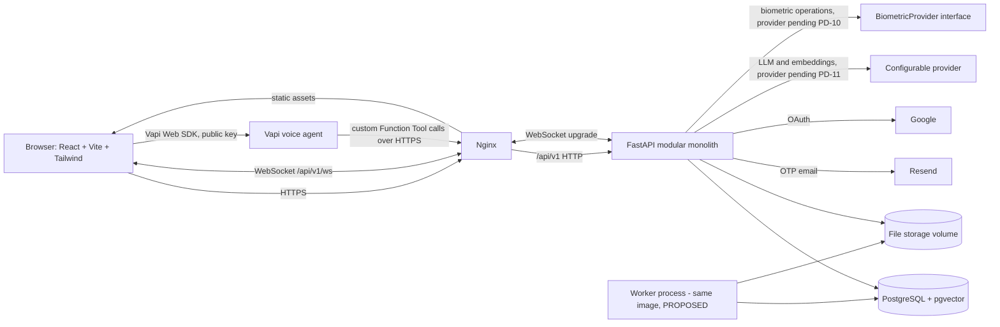

# 05 — System Architecture

> **Provenance — read before trusting any "existing repository" statement.** Statements about the existing CampusGPT repository come from a read-only audit of an **older snapshot** (`CampusGPT-main.zip`) made earlier in this project. That snapshot is **not** the current live repository, nothing was executed, and no database was touched. All such statements are labelled **PO-RV — Previously observed, re-verification required**. The codebase is the source of truth for what exists; this documentation defines the intended architecture and requirements. Where they disagree, document the discrepancy and request review. Every prompt requires Antigravity to inspect the actual repository before acting; file paths in this package are previously observed paths, not guaranteed ones.

## 1. Style
A **modular monolith**: one FastAPI application, one PostgreSQL database (with pgvector), one React single-page application. Background document processing runs as another process of the *same* backend image (a worker, not a separate service). No Redis, no ChromaDB, no microservices.

## 2. Logical view (target; items marked PROPOSED do not exist)

## 2a. Real-time, voice and biometric paths
- **WebSocket** carries chat streaming and live attendance (doc 19, `docs/architecture/WebSocket_Protocol.md`). No Redis; scaling is decision PD-25.
- **Vapi** voice agents call secured FastAPI tool endpoints; Vapi has no database access (doc 37).
- **Face recognition and liveness** run behind a `BiometricProvider` interface inside the backend; the provider is pending (PD-10) (doc 14).

## 3. What exists today (PO-RV — previously observed, re-verification required)
| Component | Status |
|---|---|
| React SPA (landing, auth screens, `/app` placeholder) | IMPLEMENTED (PO-RV) |
| FastAPI app with `auth` module | IMPLEMENTED BUT DEFECTIVE (PO-RV) |
| PostgreSQL 16 + pgvector image in Compose | IMPLEMENTED (PO-RV) (extension not migrated) |
| Nginx config (production frontend image) | IMPLEMENTED (PO-RV) (not used in dev Compose) |
| Worker, file storage, LLM adapter | NOT IMPLEMENTED |

## 4. Module boundaries (backend)
Authentication, users, students, faculty, academic structure, attendance, timetable, assignments, notices/notifications, documents, AI (orchestrator, routing, tools), RAG, analytics, placements, opportunities, courses, visual, admin, audit. Modules call each other only through service functions, never by importing another module's repository; this keeps the permission checks in one place.

## 5. Cross-cutting concerns
| Concern | Approach |
|---|---|
| AuthN | Existing JWT; rotation and revocation in WP6 |
| AuthZ | Role from DB + resource-level checks in services; designations later |
| Config | Validated `Settings`; production guards (WP3) |
| Errors | Standard envelope for new modules |
| Logging/audit | Structured logs, request IDs, `audit_logs` (WP11) |
| Files | Storage interface (PD-12) |
| Async work | DB-backed job rows claimed with `SKIP LOCKED` |

## 6. Deployment view
See doc 30: development Compose (bind mounts, reload) and production Compose (built images, no DB port, one-shot migrate service).

## 7. Key decisions
See the [ADR index](architecture/adr/README.md) (the count is computed there from the actual files).
