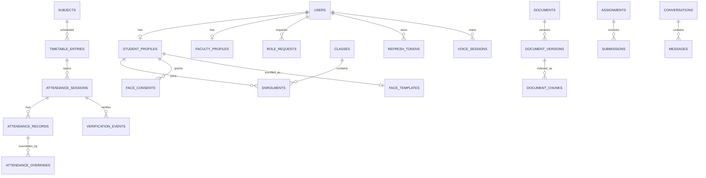

# 08 — Database Architecture

> **Provenance — read before trusting any "existing repository" statement.** Statements about the existing CampusGPT repository come from a read-only audit of an **older snapshot** (`CampusGPT-main.zip`) made earlier in this project. That snapshot is **not** the current live repository, nothing was executed, and no database was touched. All such statements are labelled **PO-RV — Previously observed, re-verification required**. The codebase is the source of truth for what exists; this documentation defines the intended architecture and requirements. Where they disagree, document the discrepancy and request review. Every prompt requires Antigravity to inspect the actual repository before acting; file paths in this package are previously observed paths, not guaranteed ones.

## 1. Principles
PostgreSQL only. SQLAlchemy 2.x models; Alembic **additive** migrations; UUID primary keys (as the existing tables use — REQUIRES VERIFICATION of the exact type); timestamps with time zone; foreign keys enforced; soft delete only where retention requires it. No second user table: every person is a row in `users`, with profile tables referencing it.

## 2. Existing schema (audit-reported)
| Object | Status |
|---|---|
| `users` | IMPLEMENTED (PO-RV) |
| `otp_verifications` | IMPLEMENTED (PO-RV) (defect C2) |
| `alembic_version` | IMPLEMENTED (PO-RV); head reported as `0005` (REQUIRES VERIFICATION) |
| PostgreSQL enums: user role, college, auth provider, OTP purpose | IMPLEMENTED (PO-RV) |
| pgvector extension | NOT IMPLEMENTED as a migration |

## 3. Proposed foundation additions (Stage 0)
| Object | Work package | Shape |
|---|---|---|
| `role_requests` | WP2 | id, user_id FK users, requested_role, status[PENDING|APPROVED|REJECTED], reviewed_by FK users, reviewed_at, note, created_at |
| `login_codes` | WP4 | id, code_hash UNIQUE, user_id FK users, expires_at, used_at, created_at |
| `refresh_tokens` | WP6 | id, jti UNIQUE, family_id, user_id FK users, issued_at, expires_at, revoked_at, replaced_by, user_agent, ip_hash |
| `auth_attempts` | WP5 | id, action, identifier_hash, ip_hash, success, created_at; index (action, identifier_hash, created_at) |
| `audit_logs` | WP11 | id, actor_id, action, target_type, target_id, outcome, ip_hash, request_id, metadata JSON, created_at (append-only) |
| `otp_verifications.verified_at` | WP2 | nullable timestamptz; set only on successful verification |

## 4. Proposed academic structure (Stage 1)
| Object | Decision / phase | Shape |
|---|---|---|
| `institutions` | PD-07 | id, name, college_code — only if multi-tenant is chosen |
| `departments / branches / programs` | P05 | id, name, (institution_id per PD-07), parent keys |
| `academic_years / semesters / terms` | P05 | id, label, starts_on, ends_on |
| `subjects` | P05 | id, code, name, credits, branch_id, semester_id |
| `classes` | P05 | id, name, branch_id, academic_year_id, semester_id |
| `enrolments` | P05 | id, student_id, class_id, term_id; UNIQUE(student_id, class_id, term_id) |
| `designations / user_designations` | PD-14 | configurable HOD/Dean/Coordinator scopes |

Institution scoping: until PD-07 is decided, design new tables so that adding an `institution_id` column later is a single additive migration with a backfill from `users.college`.

## 5. Proposed module tables
Listed per module in docs 13–27 and consolidated in doc 09.

## 6. ER overview (PROPOSED, simplified)

Full diagram: `docs/architecture/diagrams/04_database_er.md`.

## 7. Migration policy
See `docs/foundation-stabilisation/Database_Backup_and_Migration_Safety.md`. Summary: additive only, hand-reviewed, backed up, single head, forward-only in production, never edit existing revisions.

## 8. Vector storage (PROPOSED, P14)
`document_chunks.embedding vector(N)` plus a `tsvector` column for hybrid search; dimension fixed by PD-11; permission metadata on the chunk row or joined from the document ACL.

## 9. Data retention
Conversations: user-deletable. Biometrics: deleted on withdrawal. Audit logs: retained per institutional policy (to be set). Documents: per retention rule in doc 18.
