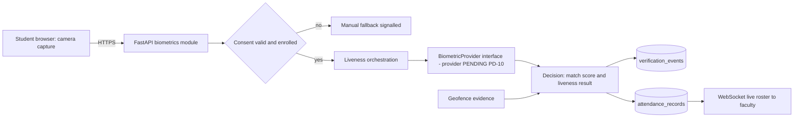
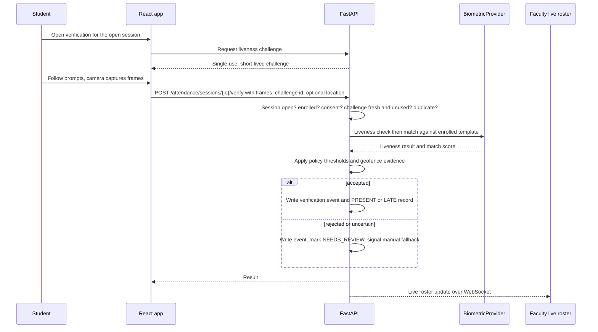

# 14 — Face Recognition and Liveness

**Product status:** REQUIRED core attendance capability (planned, NOT IMPLEMENTED). This is not an optional or deferred feature.
**Open decision:** the face-recognition/liveness **provider and biometric policies are PENDING (PD-10)**. No vendor is selected or implied. Production enablement waits for PD-10 and a privacy/legal review; design and provider-agnostic development proceed now (phase P07, slice B).

> **Provenance — read before trusting any "existing repository" statement.** Statements about the existing CampusGPT repository come from a read-only audit of an **older snapshot** (`CampusGPT-main.zip`) made earlier in this project. That snapshot is **not** the current live repository, nothing was executed, and no database was touched. All such statements are labelled **PO-RV — Previously observed, re-verification required**. The codebase is the source of truth for what exists; this documentation defines the intended architecture and requirements. Where they disagree, document the discrepancy and request review. Every prompt requires Antigravity to inspect the actual repository before acting; file paths in this package are previously observed paths, not guaranteed ones.

## 1. Purpose and scope
Verify that the enrolled student is physically present when attendance is taken. Verification happens inside a faculty-controlled attendance session linked to a timetable entry (doc 13). Face recognition answers "is this the enrolled student?"; liveness answers "is a real, present person showing their face right now?"; geofence and device signals add supporting evidence. None of these is treated as infallible, so a manual fallback and faculty override always exist.

## 2. Roles
| Role | Capabilities | Explicit restrictions |
|---|---|---|
| STUDENT | Grant/withdraw consent, enrol, verify during an open session, delete own template | Cannot verify for sessions of classes they are not enrolled in |
| FACULTY | Watch verification outcomes live, override manually with a reason | **Cannot see raw images or templates** |
| ADMIN | Set biometric policy (thresholds, retention, geofence), review audit | **Cannot view templates or raw images** |

## 3. Architecture

`BiometricProvider` exposes enrol, verify, liveness-check and delete operations. Development and tests use a **clearly-labelled mock provider**; a simulation must never be described as real secure biometric verification.

## 4. Consent
- Explicit, informed, versioned consent screen before any capture; plain-language purpose, what is stored, retention, who can access it, how to withdraw.
- Consent is recorded (`face_consents`) with the policy version; a new policy version requires fresh consent.
- Withdrawal deletes the template and stops future biometric processing; attendance history is preserved.
- No consent, or withdrawn consent → **manual fallback** with no academic penalty.

## 5. Enrolment
1. Student must be authenticated and consented.
2. Capture several samples with quality checks (lighting, pose, single face).
3. Provider derives a template; the template is encrypted before storage; **raw images are deleted after processing** (no raw-image retention by default).
4. Enrolment events are audited. Re-enrolment replaces the template and deletes the old one.
Protection against enrolment poisoning (someone enrolling another person's face): enrolment requires an authenticated session and may require faculty/admin-supervised confirmation — the exact rule is a PD-10 policy item.

## 6. Verification flow

## 7. Liveness verification
Blink detection can be **one** signal; it is not the complete liveness solution. The design combines:
| Signal | What it helps with | Limits |
|---|---|---|
| Active challenge-response (random prompts such as turn head, read digits) | Printed photos, pre-recorded video | Can be defeated by interactive attacks; usability cost |
| Passive presentation-attack detection (texture, depth, reflection cues) | Photos, screens, some masks | Depends on provider quality; evolving attacks |
| Blink / micro-movement | Static photographs | Easily reproduced by video replay |
| Single-use, short-lived server challenge bound to session and student | Replay of earlier captures | Does not stop live relay attacks |
| Device/session signals (camera presence, session binding, rate limits) | Scripted and automated submission | Not proof of identity |
| Geofence/GPS | Remote attendance | Not proof of presence; spoofable |
The documentation states residual risk honestly: no combination guarantees protection against a determined attacker; manual review and audit remain in place.

## 8. Threat model
| Threat | Mitigation | Residual risk |
|---|---|---|
| Printed photograph of the student | Active challenge, passive PAD | Low–medium, provider-dependent |
| Phone/screen replay of a photo or video | Random challenges, PAD, single-use challenge, session binding | Medium |
| Pre-recorded or injected video stream (virtual camera, deepfake) | Challenge freshness, provider injection-attack detection if available, anomaly review | Medium–high; needs provider capability |
| 3D mask | PAD (provider-dependent) | Medium |
| Proxy attendance (a friend verifies using their own face) | Match against the enrolled template of the signed-in student; duplicate prevention; audit | Low |
| Account sharing / someone else logged in | Auth hardening (WP2–WP6), session binding, rate limits | Medium |
| Location spoofing | Geofence is supporting evidence only; faculty review of anomalies | Medium |
| Enrolment poisoning | Authenticated, consented enrolment; policy for supervised enrolment (PD-10) | Medium |
| Template theft | Encryption at rest, key separation, restricted access, no raw images retained | Low–medium |
| Insider misuse | Role restrictions, audit, no template/image access for admins or faculty | Low |
| Provider breach or misuse | Provider due diligence, data-processing terms, minimised data sent (PD-10) | Needs review |
| Replay of API requests | Challenge ids, nonces, short expiry | Low |

## 9. Geofencing and GPS
Campus polygon(s) are configured by admins. Location is optional supporting evidence recorded on the verification event. A location outside the geofence does not automatically reject attendance; it flags the event for faculty review according to policy. GPS is never presented as definitive proof of physical presence.

## 10. Duplicate attendance prevention
Database unique constraint on (session, student); server-side idempotency; challenge single use; rate limits per student and per session; rejected duplicates recorded as events.

## 11. Manual fallback and faculty override
Fallback is available whenever verification fails, is uncertain, the provider is down, the camera is unavailable, or the student has not consented. Faculty can mark manually or override a verification result; every override records reason, actor, time and the previous status in `attendance_overrides` and the attendance audit log. Overrides are visible to the student.

## 12. Data protection
- **Templates:** stored encrypted (`face_templates.template_encrypted`) with managed keys (`key_id`); decryption only inside the biometrics service.
- **Raw images/frames:** processed in memory or short-lived storage and deleted immediately after processing; never stored with attendance records.
- **Retention:** template deleted on withdrawal, on leaving the institution, and after the configured retention period (`biometric_policies.retention_days`, value pending PD-10).
- **Access:** only the biometrics service handles templates; faculty and admins see outcomes and scores summaries, not templates or images; database access to the table is restricted.
- **Logging:** never log images, templates or raw scores per frame; log outcomes only.
- **Backups:** encrypted; deletion propagates according to documented backup rotation.

## 13. Data model (PROPOSED)
`face_consents`, `face_templates`, `liveness_challenges`, `verification_events`, `biometric_policies`, `geofences`, plus `attendance_records.verification_event_id` and `attendance_overrides` (doc 09). All additive migrations; no changes to `users` beyond what other phases require.

## 14. API (PROPOSED)
| Method | Path | Who | Purpose |
|---|---|---|---|
| POST | `/api/v1/biometrics/consent` | STUDENT | grant or withdraw consent |
| POST | `/api/v1/biometrics/enrol` | STUDENT | enrol (consent required) |
| DELETE | `/api/v1/biometrics/me` | STUDENT | delete own template |
| POST | `/api/v1/attendance/sessions/{id}/liveness-challenge` | STUDENT | issue a single-use challenge |
| POST | `/api/v1/attendance/sessions/{id}/verify` | STUDENT | verify and record |
| GET / PUT | `/api/v1/admin/biometric-policy` | ADMIN | read / update policy (audited) |
| WS | `/api/v1/ws/attendance/{session_id}` | FACULTY owner | live verification events |

## 15. UI states
Consent, enrolment (progress and quality hints), verification (camera permission denied, no camera, low light, challenge prompts, success, rejected, uncertain → manual fallback, offline), faculty monitor (verified / pending / needs review / manual), admin policy.

## 16. Error handling
Standard error envelope (doc 10). Provider timeouts and outages produce a clear "use manual fallback" outcome, not silent failure; failed attempts are rate limited; no raw biometric data appears in error messages.

## 17. Testing and evaluation
- Unit/API tests with the mock provider: consent gates, challenge single use and expiry, duplicate prevention, fallback paths, override audit, permission matrix, deletion on withdrawal.
- Before any production claim: evaluate the chosen provider with a **consented, synthetic or volunteer** presentation-attack test set and measure false accept/false reject rates in a pilot; thresholds are policy values set by the institution (not invented here).
- Security tests: replayed challenge, cross-student submission, tampered session id.

## 17a. Privacy and legal review (required before production)
Applicable data-protection law and institutional policy must be reviewed (for example India's Digital Personal Data Protection Act, 2023, plus any institutional rules) — **legal review required; this document is not legal advice**. Review covers lawful basis and consent, children/minors if any, purpose limitation, retention, cross-border processing by providers, breach procedure, data-subject rights and a privacy-impact assessment.

## 18. Provider decision criteria (PD-10)
Evaluate candidates (self-hosted libraries, managed APIs, on-device processing) on: liveness/PAD capability and independent evaluation, accuracy on the institution's population, template format and exportability, where data is processed and stored, deletion guarantees, cost, latency, failure behaviour, and contractual data-processing terms. **No provider is chosen here.**

## 19. Acceptance criteria
- [ ] Consent, enrolment, verification, liveness, geofence evidence, duplicate prevention, fallback, override and audit implemented behind `BiometricProvider` and tested.
- [ ] Faculty/admin cannot access templates or raw images (tested).
- [ ] Withdrawal deletes the template (tested).
- [ ] Mock provider is labelled and cannot be enabled in production.
- [ ] PD-10 decided and privacy/legal review recorded before production enablement.
