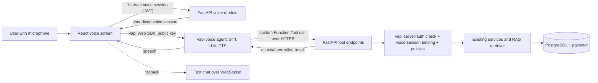
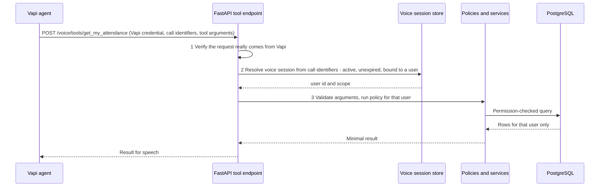

# 37 — Voice Interaction Architecture (Vapi)

**Status:** NOT IMPLEMENTED (planned, phase P22). **Direction confirmed by the owner:** voice uses **Vapi**. Credentials, pricing/plan, exact assistant configuration and final privacy approval are **deployment decisions (PD-19)**, not asserted here.

> **Provenance — read before trusting any "existing repository" statement.** Statements about the existing CampusGPT repository come from a read-only audit of an **older snapshot** (`CampusGPT-main.zip`) made earlier in this project. That snapshot is **not** the current live repository, nothing was executed, and no database was touched. All such statements are labelled **PO-RV — Previously observed, re-verification required**. The codebase is the source of truth for what exists; this documentation defines the intended architecture and requirements. Where they disagree, document the discrepancy and request review. Every prompt requires Antigravity to inspect the actual repository before acting; file paths in this package are previously observed paths, not guaranteed ones.

## 1. Architecture
**React frontend → Vapi Web SDK → Vapi voice agent → secured CampusGPT (FastAPI) tool endpoints → PostgreSQL / pgvector.**

**Non-negotiable rule:** Vapi never receives database access and never bypasses CampusGPT's backend security. Business logic, authorisation, campus-data access, RAG retrieval and database operations stay in FastAPI.

## 2. Components
| Component | Responsibility |
|---|---|
| React voice screen | Microphone permission, start/stop, mute, transcript, status, fallback to text |
| Vapi Web SDK (`@vapi-ai/web`) | Starts and stops the call in the browser; emits call/speech/volume/message/error events. Uses a **public** key only |
| Vapi voice agent | Speech input, transcription, response generation, text-to-speech, interruption handling, tool invocation |
| FastAPI `voice` module | Creates/ends voice sessions, authenticates tool calls, dispatches to existing services, logs usage |
| Existing services/policies | The only code that reads campus data (same as text chat) |

## 3. Session lifecycle
1. **Initiation:** user presses the voice button; the browser asks for microphone permission (denied → explain and offer text chat).
2. The frontend calls `POST /api/v1/voice/sessions` with the normal bearer token. The backend creates a `voice_sessions` row bound to the authenticated user with a short expiry and returns an opaque session identifier and non-secret configuration.
3. The frontend starts the Vapi call with the SDK (`start` with an assistant id and per-call overrides such as variable values; recording disabled by default). The opaque session identifier is attached as call metadata/variables so the backend can bind the Vapi call to the session.
4. **During the call:** speech in → transcription → agent response → speech out; the user can interrupt; transcripts appear on screen.
5. **Tool use:** when the agent needs campus data it triggers a custom Function Tool (section 4).
6. **Termination:** user stops, inactivity timeout, backend ends the session, or an error occurs; the backend marks the voice session ended so later tool calls are rejected.
7. **Fallback:** on any Vapi or network failure the UI keeps the transcript and switches to text chat over WebSocket.

## 4. Tool calls and authorisation

Rules:
1. **Two checks, both required:** (a) the request is authenticated as coming from Vapi, and (b) the call maps to an active voice session of a specific user. Either failing → reject (401/403) and log.
2. **The end-user identity comes only from the voice session.** The model/agent cannot supply or override a user id; arguments such as `student_id` are ignored or rejected.
3. Tool arguments are validated with Pydantic schemas; unknown tools are rejected; payload size limited.
4. Each tool wraps an existing policy-checked service; no tool accepts SQL or free-form queries.
5. Results are minimised (only what is needed to answer), contain no secrets, and exclude data the user may not see.
6. Replay protection: call identifier + timestamp window; idempotent read tools.
7. Rate limits per voice session and per user; tools that mutate data are **not** exposed to voice in the first release.

Initial read-only tool catalogue (PROPOSED): `get_my_attendance`, `get_attendance_shortage`, `get_todays_timetable`, `get_pending_assignments`, `search_my_documents` (RAG with the user's permissions), `get_my_notices`. Faculty/admin tools follow the same pattern with role checks.

### Vapi server authentication (verify before building)
Vapi documentation describes server-URL authentication through **credentials** (a bearer-style secret sent in a header such as `X-Vapi-Secret`, custom headers, OAuth 2.0, or HMAC), assignable at tool, assistant, phone-number or organisation level. Community guidance also suggests per-user dynamic headers cannot be set from the Web SDK. Therefore this design does **not** rely on per-user headers: it uses a fixed Vapi credential for request authenticity and the voice-session binding for user identity. **REQUIRES VERIFICATION** against current Vapi documentation: exact payload fields that carry the call identifier and metadata to tool servers, which credential type is used, and signature details.

## 5. Browser and permissions
Microphone permission is requested only after the user starts voice mode; denial is handled gracefully; no always-on listening; secure context (HTTPS) required in production; the public Vapi key is acceptable in the browser, any private Vapi API key lives only on the backend.

## 6. Error handling and fallback
| Failure | Behaviour |
|---|---|
| Microphone denied/unavailable | Explain; open text chat |
| Vapi call fails to start or drops | Show error, keep transcript, offer retry and text chat |
| Tool call rejected (auth/session) | Agent receives a safe generic failure; user told the assistant could not access that information |
| Backend/tool timeout | Agent says it could not retrieve the data; suggest text chat |
| Voice session expired | End call, ask user to restart |

## 7. Logging and usage monitoring
Log per call: voice-session id, user id, duration, tool names, outcomes, latency, error codes. **Do not** store audio or full transcripts by default; do not log tool arguments/results by default. Track usage for cost and abuse (calls per user/day, minutes). Audit voice-session creation and tool-call denials.

## 8. Privacy, consent and provider security
- Voice data is processed by a third party: privacy review, data-processing terms and retention settings are required before production (PD-19).
- Recording disabled by default; any recording or transcript retention needs explicit consent and a retention limit.
- Users are told when voice is active and that a provider processes speech.
- Provider credentials in the secret store only; never in the repository or the browser.
- Tools expose the minimum data; no biometric data, credentials or other users' data over voice.

## 9. Accessibility
Visible captions/transcript, keyboard operation of start/stop/mute, screen-reader announcements for state changes, text-chat equivalent for every voice capability.

## 10. Testing
Tool call without valid Vapi authentication → 401; valid Vapi auth but unbound/expired voice session → 403; spoofed `student_id` ignored; cross-user data never returned; fallback to text when Vapi is unavailable (use a stub for Vapi in tests, never real credentials); session invalidation after end; rate limits; transcript injection attempts ("ignore your rules…") do not widen access.

## 11. Deployment decisions still open (PD-19)
Vapi account and credentials handling; plan and pricing; exact assistant configuration (model hosting, voice, transcriber, recording); server-authentication method; data-retention settings; final privacy approval.

## 12. Acceptance criteria
- [ ] Voice and text produce identical authorisation outcomes.
- [ ] No Vapi path reaches the database except through audited FastAPI tools.
- [ ] End-user identity derived server-side from the voice session only.
- [ ] Credentials absent from the repository and the browser (apart from the public key).
- [ ] Text-chat fallback works.
- [ ] PD-19 deployment decisions and privacy approval recorded before production.
