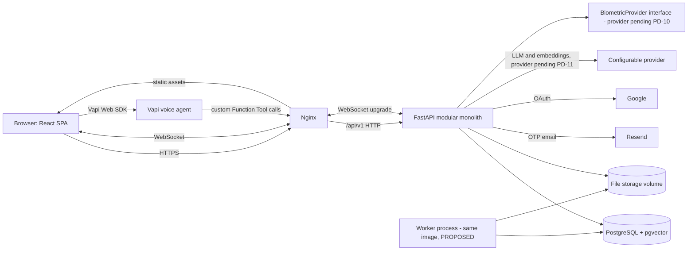

# Diagram 01 — High-level system architecture

**Status:** TARGET (PROPOSED); existing-repository parts are PO-RV (previously observed, re-verify)

Vapi reaches the database only through authenticated FastAPI tool endpoints. See docs 05, 14, 37.
