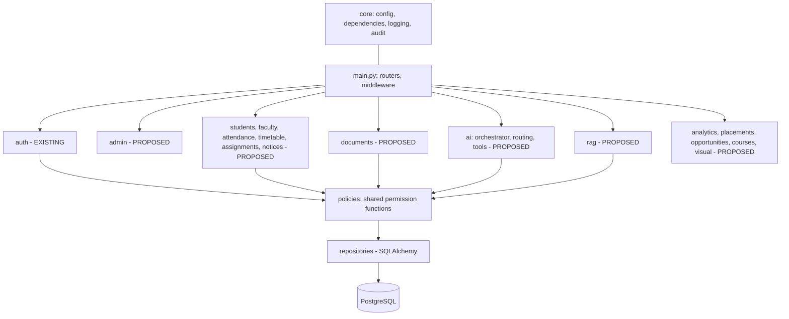

# Diagram 03 — Backend modular monolith

**Status:** EXISTING: auth module only; others PROPOSED

Every module calls permission functions in one place; AI tools use the same policies as HTTP routes.
