# Diagram 04 — Database ER diagram

**Status:** PROPOSED except USERS and OTP_VERIFICATIONS (PO-RV)

```mermaid
erDiagram
    USERS ||--o{ OTP_VERIFICATIONS : receives
    USERS ||--o{ ROLE_REQUESTS : requests
    USERS ||--o{ REFRESH_TOKENS : owns
    USERS ||--o{ LOGIN_CODES : exchanges
    USERS ||--o{ AUDIT_LOGS : performs
    USERS ||--o| STUDENT_PROFILES : has
    USERS ||--o| FACULTY_PROFILES : has
    STUDENT_PROFILES ||--o{ ENROLMENTS : joins
    CLASSES ||--o{ ENROLMENTS : contains
    SUBJECTS ||--o{ TIMETABLE_ENTRIES : scheduled_in
    CLASSES ||--o{ TIMETABLE_ENTRIES : attends
    FACULTY_PROFILES ||--o{ FACULTY_ASSIGNMENTS : teaches
    SUBJECTS ||--o{ FACULTY_ASSIGNMENTS : covers
    TIMETABLE_ENTRIES ||--o{ ATTENDANCE_SESSIONS : opens
    ATTENDANCE_SESSIONS ||--o{ ATTENDANCE_RECORDS : has
    STUDENT_PROFILES ||--o{ ATTENDANCE_RECORDS : marked
    ATTENDANCE_SESSIONS ||--o{ VERIFICATION_EVENTS : verifies
    ATTENDANCE_RECORDS ||--o{ ATTENDANCE_OVERRIDES : overridden_by
    STUDENT_PROFILES ||--o{ FACE_CONSENTS : grants
    STUDENT_PROFILES ||--o| FACE_TEMPLATES : enrolled_as
    ATTENDANCE_SESSIONS ||--o{ LIVENESS_CHALLENGES : issues
    ASSIGNMENTS ||--o{ SUBMISSIONS : receives
    STUDENT_PROFILES ||--o{ SUBMISSIONS : submits
    SUBMISSIONS ||--o| EVALUATIONS : evaluated_by
    NOTICES ||--o{ NOTICE_TARGETS : targets
    NOTICES ||--o{ NOTICE_READS : read_by
    DOCUMENTS ||--o{ DOCUMENT_VERSIONS : versions
    DOCUMENT_VERSIONS ||--o{ DOCUMENT_CHUNKS : indexed_as
    DOCUMENTS ||--o{ DOCUMENT_ACL : governed_by
    USERS ||--o{ CONVERSATIONS : owns
    CONVERSATIONS ||--o{ MESSAGES : contains
    MESSAGES ||--o{ MESSAGE_SOURCES : cites
    USERS ||--o{ VOICE_SESSIONS : starts
    VOICE_SESSIONS ||--o{ VOICE_TOOL_CALLS : records
    COMPANIES ||--o{ PLACEMENT_OPPORTUNITIES : posts
    PLACEMENT_OPPORTUNITIES ||--o{ PLACEMENT_APPLICATIONS : receives
    COURSES ||--o{ COURSE_PROGRESS : tracked_by
    USERS ||--o{ VISUAL_BOARDS : draws
```

Institution scoping (PD-07) is not drawn until decided. Only `users` and `otp_verifications` were previously observed.
