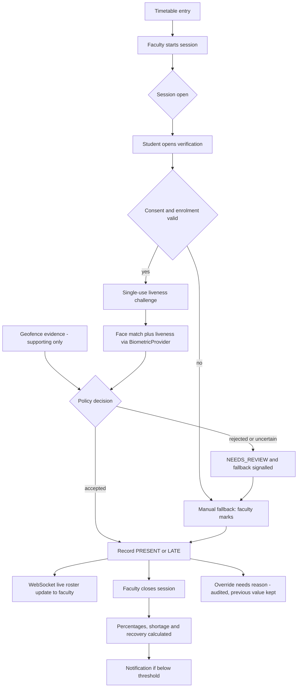

# Diagram 10 — Attendance workflow (face recognition and liveness are required)

**Status:** PROPOSED (P07 slices A and B); provider pending PD-10

Duplicate attendance is prevented by a unique (session, student) constraint. Faculty cannot see raw images or templates.
