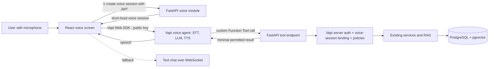
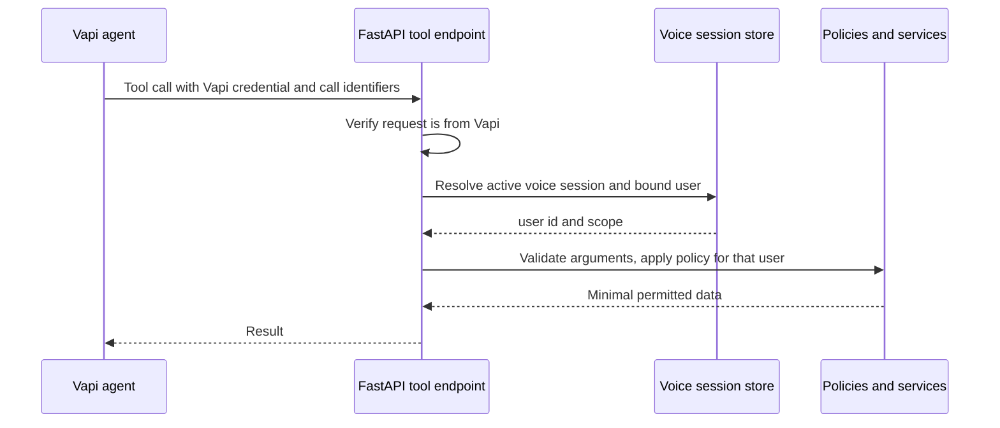

# Diagram 19 — Vapi voice architecture

**Status:** PROPOSED (P22); deployment details PD-19

Vapi has no database access; user identity is derived from the voice session, never from model-supplied arguments (doc 37).
