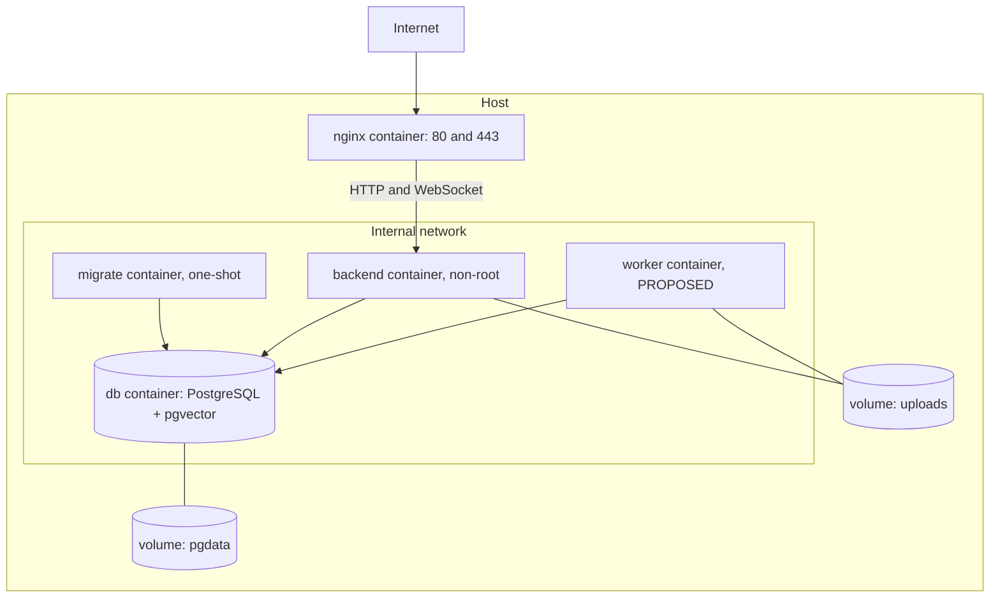

# Diagram 20 — Docker deployment architecture

**Status:** PROPOSED production layer (WP8); development layer partly EXISTING

The database port is not published in production; migrate runs before the API starts.
