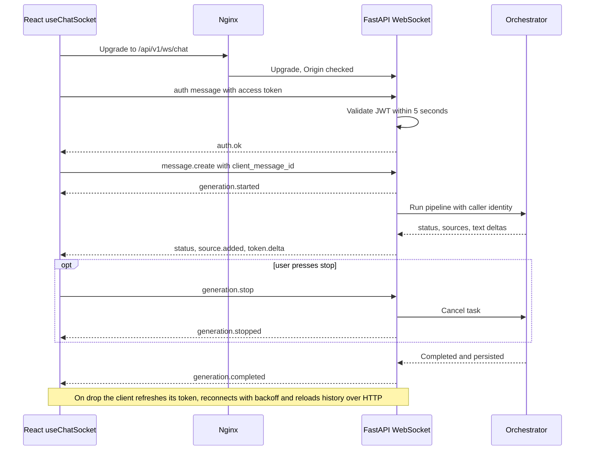

# Diagram 23 — WebSocket communication flow

**Status:** PROPOSED (P12; live attendance P07); PD-18 parameters, PD-25 scaling

WebSocket is the only real-time transport; no Redis. See `docs/architecture/WebSocket_Protocol.md`.
