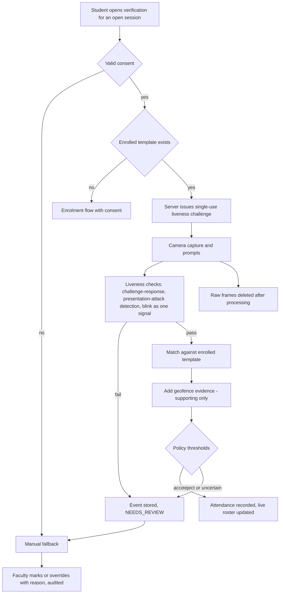

# Diagram 24 — Face recognition and liveness workflow

**Status:** PROPOSED (P07 slice B); provider pending PD-10

No component of this workflow guarantees protection against every spoofing attack; manual review and audit remain (doc 14).
