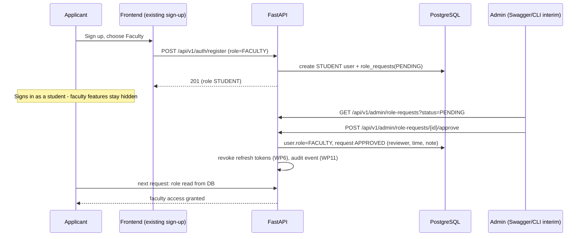

# Faculty Approval Workflow

**Status:** NOT IMPLEMENTED. PROPOSED in WP2. Interim approval path (Swagger + CLI vs temporary admin UI) is PENDING APPROVAL (PD-01). Staff/student email-domain assumption is PD-02.

## Actors
Applicant (a registered STUDENT who asked for FACULTY), Administrator, the system.

## Workflow

## States
`PENDING → APPROVED | REJECTED`. A user may have one open request at a time. A rejected user may re-apply after a configurable delay (PROPOSED default: 7 days).

## Endpoints (PROPOSED)
| Method | Path | Who | Purpose |
|---|---|---|---|
| GET | `/api/v1/admin/role-requests` | ADMIN | list, filter by status |
| POST | `/api/v1/admin/role-requests/{id}/approve` | ADMIN | approve with optional note |
| POST | `/api/v1/admin/role-requests/{id}/reject` | ADMIN | reject with reason |
| GET | `/api/v1/auth/me` | any | includes pending-request status (field name to be decided during implementation) |

## Rules
- The reviewer cannot be the applicant.
- Approval sets the role in one transaction with the status change.
- Both outcomes are recorded (reviewer, time, note) and, after WP11, audited.
- Notification to the applicant uses the notification module when it exists (P10); until then the status appears in `/auth/me`.
- Faculty privileges still require assignment to subjects/classes (P05+); approval alone does not grant access to any class data.

## Interim tooling
CLI: `python -m app.manage_role_requests list|approve|reject` (name illustrative; follows `create_admin.py`). A real admin screen arrives with the Admin Dashboard (P21).

## Verification requirements
Approval/rejection tests, self-approval block, concurrent double-approval safety (second call fails cleanly), and a check that pending users get 403 on faculty-only routes.
