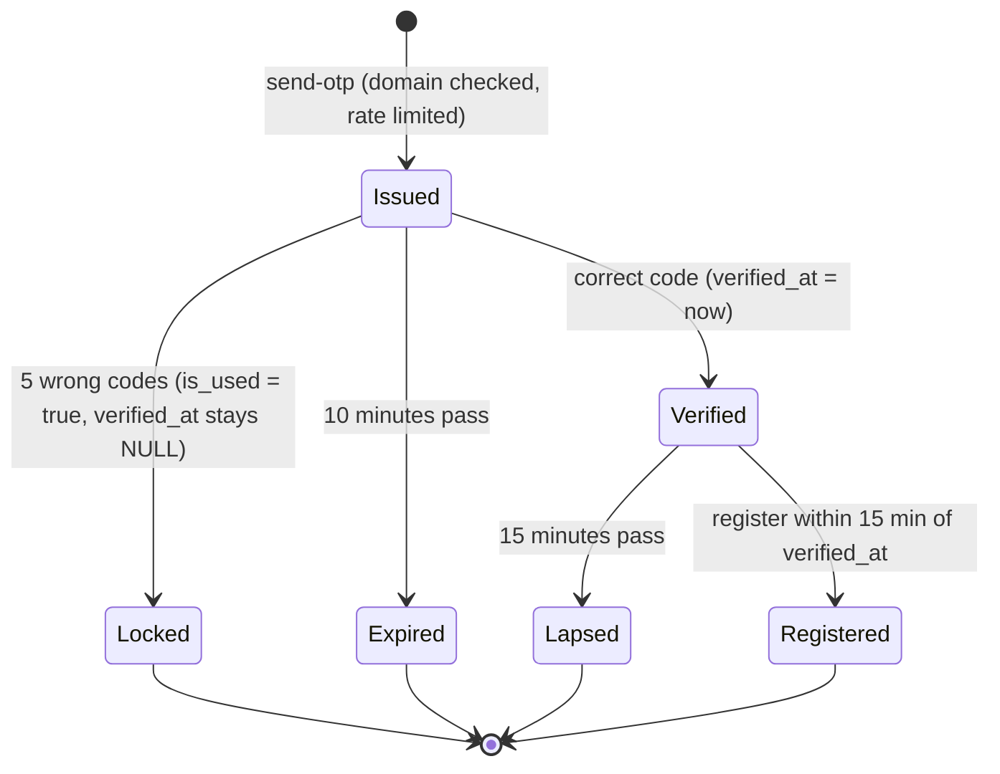

# OTP Verification (defect C2)

**Status:** previously observed as defective (PO-RV — confirm on the live code first). Fix is PROPOSED in WP2.

> **Provenance — read before trusting any "existing repository" statement.** Statements about the existing CampusGPT repository come from a read-only audit of an **older snapshot** (`CampusGPT-main.zip`) made earlier in this project. That snapshot is **not** the current live repository, nothing was executed, and no database was touched. All such statements are labelled **PO-RV — Previously observed, re-verification required**. The codebase is the source of truth for what exists; this documentation defines the intended architecture and requirements. Where they disagree, document the discrepancy and request review. Every prompt requires Antigravity to inspect the actual repository before acting; file paths in this package are previously observed paths, not guaranteed ones.

## Current behaviour (audit-reported)
1. `POST /api/v1/auth/send-otp` creates an `otp_verifications` row (hashed code, 10-minute expiry, `attempts`, `is_used`) and emails the code through Resend. Limit: 3 sends per 15 minutes per email.
2. `POST /api/v1/auth/verify-otp` compares the code. A correct code sets `is_used = true`. A wrong code increments `attempts`; at 5 attempts `is_used` is also set to true.
3. `POST /api/v1/auth/register` calls `has_recent_used_email_otp(email)`, which returns true for **any** used, unexpired EMAIL_VERIFY row.

**The defect:** a locked-out record (five wrong guesses) is indistinguishable from a verified one, so registration succeeds for an email the caller does not own. Additional weaknesses: `send-otp` skips the domain check when `college` is omitted; an email-provider failure surfaces as HTTP 500.

## Target design (PROPOSED)

- New nullable column `verified_at` (additive). Set only in the success branch.
- Registration requires a row for the **same email** with `verified_at` within the last 15 minutes. Old rows (no `verified_at`) never count.
- `send-otp` always validates the email domain: derive the college from the domain, reject unrecognised domains.
- Provider failure → HTTP 503 with a generic message; the row remains but counts toward rate limits.
- WP5 later caps total guesses per email per hour regardless of new codes.

## Enumeration and linking protections (WP2)
- `send-otp`, `forgot-password` and `login` return the same status, body and approximate timing whether or not the account exists; when an account already exists no verification code is sent (a neutral notice to the address owner is optional).
- A Google sign-in links to an existing local account only if the Google email is verified, the institutional domain is allowed server-side and the local account's email is verified; link events are audited.

## Rules
- OTPs are stored hashed and never logged.
- Codes are single use and 6 digits; comparison is constant-time (bcrypt verify).
- Error messages stay generic.

## Test matrix
| Case | Expected |
|---|---|
| 5 wrong codes, then register | rejected |
| correct code, register within 15 min | accepted |
| correct code, register after 15 min | rejected |
| verification for A, register B | rejected |
| unrecognised domain | 400 |
| provider failure | 503 |
| replay of used code | rejected |

## Migration impact
Users midway through sign-up when the migration is deployed must verify again. No user data is touched.
