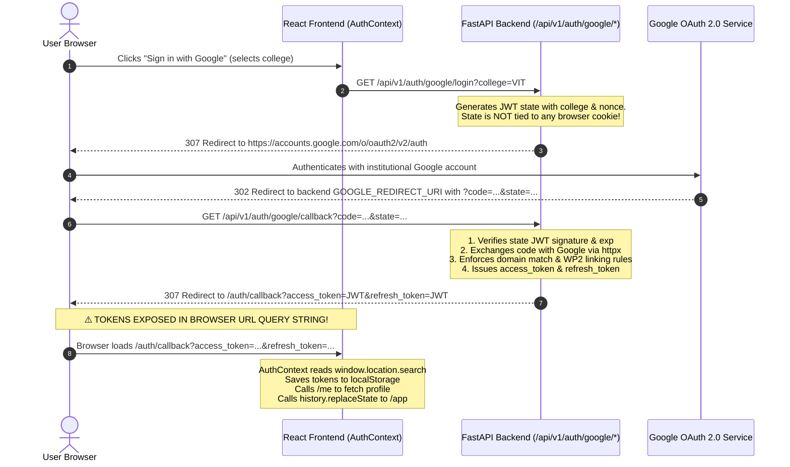

# WP4 Implementation Plan — Google OAuth Security Hardening (Revision 4)

**Status:** Planning complete — Implementation pending approval  
**Revision:** 4 (incorporates complete Nginx/Uvicorn logging audit, refined CSRF/binding terminology, same-site deployment limitations, and safe non-destructive cookie lifecycle)  
**Depends on:** WP0, WP1, WP2, WP3 (all completed and verified; WP3 committed at `6516bac`)  
**Estimated risk:** Low to Medium — additive database table (`login_codes`), new exchange endpoint, frontend callback handshake update  
**New external dependencies:** None (standard library `secrets`, `hashlib`, existing `fastapi`, `sqlalchemy`, `pydantic`)  

---

## 1. Objective and Exact Scope

### Objective
Completely eliminate token exposure in URL query parameters during Google OAuth, cryptographically bind the authorization exchange code to the initiating browser session, redact query strings in reverse proxy and server logs, and implement single-use atomic code consumption in PostgreSQL to defend against code theft, replay, and CSRF attacks.

### Exact Scope
1. **Remove Tokens from Redirect URLs**:
   Replace `target_url = f"{settings.FRONTEND_URL}/auth/callback?access_token=...&refresh_token=..."` with a one-time authorization code redirect: `f"{settings.FRONTEND_URL}/auth/callback?code=..."`.
2. **Reverse Proxy and Server Log Redaction for Both Callbacks**:
   - `/api/v1/auth/google/callback` (backend callback receiving Google's authorization code and state).
   - `/auth/callback` (frontend callback receiving CampusGPT's temporary exchange code).
   Configure reverse proxies (Nginx) using an `http`-context `map` directive to strip query strings (`$uri` instead of `$request_uri`) for both callback routes, and audit Uvicorn access logs.
3. **End-to-End Cryptographic Browser Binding**:
   - Generate a 256-bit cryptographically secure random nonce during login initiation.
   - Set an `HttpOnly`, `SameSite=Lax`, host-only cookie (`oauth_binding_nonce`) and embed the nonce in the signed JWT `state`.
   - Validate cookie nonce == state nonce on callback.
   - Hash the nonce (`SHA-256`) and store it with the login code record in PostgreSQL.
   - Retain the cookie until code exchange at `POST /api/v1/auth/google/exchange`.
   - Require the matching cookie nonce when exchanging the code.
4. **Complementary Origin & Content-Type Defenses**:
   - `POST /api/v1/auth/google/exchange` strictly validates the incoming `Origin` header against the configured trusted frontend origins (`CORS_ORIGINS` / `FRONTEND_URL`).
   - Require `Content-Type: application/json` to trigger CORS preflight and block simple HTML cross-site form submissions.
   - Restrict credentialed CORS (`allow_credentials=True`) strictly to explicit origins (never wildcard `*`).
5. **Additive Database Table (`login_codes`)**:
   Create `login_codes` table storing `code_hash` (SHA-256), `nonce_hash` (SHA-256), `user_id`, `expires_at` (60s TTL), and `used_at`. Raw codes and raw nonces are **never stored**.
6. **Atomic PostgreSQL Consumption**:
   Execute a single atomic `UPDATE ... WHERE used_at IS NULL ... RETURNING user_id` query within an active transaction, committing successfully before returning tokens.
   Return a generic error response for all code validation failures:
   `{"detail": "Invalid or expired authorization code"}`
7. **Safe Non-Destructive Cookie Lifecycle**:
   Never clear `oauth_binding_nonce` indiscriminately for forged or malformed requests, preventing third-party attackers from wiping out a victim's active in-flight login attempt.
8. **Preserve All Existing Safeguards**:
   - Original `campusgpt` database remains untouched.
   - Migrations 0001–0008 preserved; additive migration 0009 only.
   - WP0 test database safety guard (`assert_test_database`) preserved.
   - WP2 account linking and institutional domain validation preserved.
   - WP3 production configuration guards preserved.

---

## 2. Current OAuth Architecture and Flow (Inspection Findings)

The live codebase (commit `6516bac`) implements Google OAuth via direct redirect with JWTs in URL parameters:



### Verified Vulnerabilities in Current Code

| ID | Vulnerability | Location | Severity | Impact |
|----|--------------|----------|----------|--------|
| **V-01** | Token leakage in URL parameters | `backend/app/auth/router.py:214` | High | Access and refresh tokens leak into browser history, server/proxy access logs, HTTP `Referer` headers, and browser extensions. |
| **V-02** | Unbound OAuth state (Login CSRF) | `backend/app/auth/service.py:53-75` | Medium | The OAuth `state` is a signed JWT but is not bound to a browser cookie, allowing an attacker to inject their own authorization code into a victim's session. |
| **V-03** | Long-lived refresh token exposure | `backend/app/auth/router.py:214` | High | The refresh token is valid for 7 days (`REFRESH_TOKEN_EXPIRE_DAYS=7`). Exposing it in URLs creates an extended attack window. |
| **V-04** | Plaintext query logging in reverse proxies | `frontend/nginx.conf` | Medium | Nginx `$request_uri` logs query parameters by default, writing Google authorization codes and temporary codes to disk logs. |

---

## 3. Revised Target Security Design

### 3.1 End-to-End Sequence Diagram

```mermaid
sequenceDiagram
    autonumber
    actor User as User Browser
    participant FE as React Frontend (AuthContext)
    participant Nginx as Nginx Reverse Proxy
    participant BE as FastAPI Backend (/api/v1/auth/google/*)
    participant DB as PostgreSQL (login_codes)
    participant Google as Google OAuth 2.0 Service

    User->>FE: Clicks "Sign in with Google" (selects college)
    FE->>BE: GET /api/v1/auth/google/login?college=VIT
    Note over BE: 1. Generates 256-bit random nonce<br/>2. Encodes nonce in signed JWT state<br/>3. Sets HttpOnly, SameSite=Lax host-only cookie: oauth_binding_nonce
    BE-->>User: 307 Redirect to Google + Set-Cookie: oauth_binding_nonce
    User->>Google: Authenticates with Google
    Google-->>User: 302 Redirect to backend GOOGLE_REDIRECT_URI with ?code=...&state=...
    User->>Nginx: GET /api/v1/auth/google/callback?code=...&state=... (Cookie sent)
    Note over Nginx: Access log redacts query string using $uri (no code/state logged)
    Nginx->>BE: Proxies callback request
    Note over BE: 1. Validates cookie nonce == state JWT nonce (CSRF check)<br/>2. Exchanges Google code for profile via httpx<br/>3. Enforces institutional domain & WP2 account linking<br/>4. Generates opaque 32-byte code<br/>5. Hashes code (SHA-256) & cookie nonce (SHA-256)<br/>6. Inserts into login_codes (TTL: 60s)<br/>7. KEEPS oauth_binding_nonce cookie active
    BE->>DB: INSERT INTO login_codes (code_hash, nonce_hash, user_id, expires_at)
    BE-->>User: 307 Redirect to /auth/callback?code=OPAQUE_CODE<br/>Headers: Cache-Control: no-store, Referrer-Policy: no-referrer
    User->>Nginx: GET /auth/callback?code=OPAQUE_CODE
    Note over Nginx: Access log redacts query string using $uri (no code logged)
    Nginx-->>User: Serves index.html
    Note over FE: 1. Reads ?code= parameter<br/>2. Immediately scrubs URL bar via replaceState<br/>3. POST /api/v1/auth/google/exchange with credentials: "include" & Origin header
    FE->>BE: POST /api/v1/auth/google/exchange { "code": "..." } (Cookie + Origin + JSON)
    Note over BE: 1. Validates Origin header against trusted origins<br/>2. Validates Content-Type: application/json<br/>3. Reads cookie oauth_binding_nonce<br/>4. Hashes code (SHA-256) and cookie nonce (SHA-256)<br/>5. Atomic UPDATE ... RETURNING user_id; commit transaction<br/>6. Issues access_token & refresh_token<br/>7. Clears oauth_binding_nonce cookie
    BE->>DB: UPDATE login_codes SET used_at = NOW() WHERE code_hash = :ch AND nonce_hash = :nh AND used_at IS NULL AND expires_at > NOW() RETURNING user_id;
    BE-->>FE: 200 OK + TokenResponse<br/>Headers: Cache-Control: no-store, Set-Cookie: oauth_binding_nonce=; Max-Age=0
    Note over FE: Stores session in localStorage<br/>Redirects to /app
```

---

## 4. Key Security Design Specifications

### 4.1 Complete Nginx, Server, and Logging Audit

Both callback routes handle high-entropy, short-lived authorization secrets:
1. **`/api/v1/auth/google/callback`**: Receives Google's authorization code and OAuth state.
2. **`/auth/callback`**: Receives CampusGPT's temporary exchange code.

#### Inspection of Existing Logging Infrastructure
- **`frontend/nginx.conf`**: The production image (`frontend/Dockerfile`) uses `nginx:alpine` and copies `nginx.conf` into `/etc/nginx/conf.d/default.conf`. In Nginx, `/etc/nginx/conf.d/*.conf` is included inside the top-level `http { ... }` block of `/etc/nginx/nginx.conf`.
- **`frontend/nginx.conf` Default Behavior**: Currently defines only `server { listen 80; ... }` without an explicit `access_log` directive, inheriting the global Nginx `access_log /var/log/nginx/access.log combined;` which writes the full `$request` (including `$query_string`) for all incoming requests.
- **Uvicorn Server Logging (`docker-compose.yml`)**: Uvicorn runs with `--reload`. By default, Uvicorn outputs access log lines to `stdout`: `INFO: client - "GET /api/v1/auth/google/callback?code=... HTTP/1.1" 307`.

#### Nginx Log Redaction Strategy (HTTP Context Compliance)
In Nginx configuration syntax, the `map` directive **must be declared in the `http` context** (it is invalid inside `server` or `location` blocks).

Because `/etc/nginx/conf.d/default.conf` is loaded directly inside `http { ... }` in standard Nginx container images, the `map` directive and custom log format are placed **at the file root (outside `server {}`)**:

```nginx
# --- Declared in http context (outside server block) ---
map $uri $sanitized_request_uri {
    /api/v1/auth/google/callback  $uri;
    /auth/callback                $uri;
    default                       $request_uri;
}

log_format sanitized '$remote_addr - $remote_user [$time_local] '
                     '"$request_method $sanitized_request_uri $server_protocol" '
                     '$status $body_bytes_sent "$http_referer" "$http_user_agent"';

server {
    listen 80;
    server_name _;

    # Apply sanitized logging to the entire server
    access_log /var/log/nginx/access.log sanitized;

    # ... locations ...
}
```

#### Full Logging Audit & Upstream Protection
| Log Stream | Exposure Risk | Protection Strategy |
|------------|---------------|---------------------|
| **Nginx `access_log`** | `$request` or `$request_uri` logs query string on disk. | Sanitized via `map $uri $sanitized_request_uri` in `http` context, logging `$uri` (no query params) for both callback routes. |
| **Nginx `error_log`** | At `debug` level, Nginx logs full HTTP request lines and headers. | Enforce `error_log /var/log/nginx/error.log warn;` in production. Debug logging must be disabled. |
| **HTTP `Referer` Logging** | Browser leaks callback URL to external resource requests. | FastAPI emits `Referrer-Policy: no-referrer` on callback redirect, stripping the URL from outbound `Referer` headers. |
| **Uvicorn Access Log** | Uvicorn logs raw request lines to container `stdout`. | In production, access logging is delegated to Nginx, and Uvicorn is executed with `--no-access-log` to prevent duplicate unredacted logs in container `stdout` / Docker logs. |
| **Upstream Log Aggregators** | Ingesting unredacted stdout/disk logs into CloudWatch/Datadog/Loki. | Masking at Nginx ingress + running Uvicorn with `--no-access-log` ensures log aggregators never receive authorization codes. |
| **FastAPI Application Loggers** | Developer logs query params or request bodies. | Strict code audit: no logger records `code`, `state`, `cookie`, `access_token`, `refresh_token`, or exchange bodies. |

---

### 4.2 CSRF Terminology, Browser Binding & Same-Site Deployment Limitations

#### Correct Security Terminology
- **Cryptographic Browser Binding**: The `oauth_binding_nonce` cookie (and its matching state nonce) is the primary **cryptographic browser-binding mechanism**. It cryptographically ties the authorization process to the initiating browser session, ensuring an attacker cannot inject an authorization code into a victim's session.
- **Complementary Defenses**:
  - **Exact Origin validation**: Verifies that requests arrive from trusted frontend origins.
  - **`Content-Type: application/json` enforcement**: A parser-level defense that triggers CORS preflight (`OPTIONS`) in cross-origin requests and blocks simple HTML form-based cross-site POST attacks. It is **not** a cryptographic defense.
  - **Credentialed CORS allowlisting**: Enforces that only explicit, non-wildcard origins may receive credentialed responses.

#### Cookie Policy and Deployment Realities
- **Same-Origin Deployment (Recommended & Current Architecture)**:
  - Both frontend and backend are reverse-proxied through Nginx (`http://campusgpt.dev/` and `http://campusgpt.dev/api`).
  - From the browser's perspective, all requests are strictly **same-origin**.
  - `SameSite=Lax` with `Path=/api/v1/auth` is the secure default. Cookies are sent on same-origin POST requests and top-level GET redirects from Google.
- **Same-Site Subdomain Deployment (`app.campusgpt.dev` and `api.campusgpt.dev`)**:
  - These are different origins (different FQDNs), but they share the exact same registrable domain (`campusgpt.dev`, eTLD+1), making them **same-site**.
  - Under same-site subdomain deployments, `SameSite=Lax` cookies are sent on fetch requests from `app` to `api` when `credentials: "include"` is set.
- **Different Registrable Domains (Cross-Site)**:
  - Deploying across distinct registrable domains (e.g. `campusgpt-app.vercel.app` calling `campusgpt-api.railway.app`) is **cross-site**.
  - Cross-site requires `SameSite=None; Secure`.
  - **Critical Deployment Limitation**: Setting `SameSite=None; Secure` **does not guarantee** cross-site cookie availability. Major browsers (Apple Safari ITP, Google Chrome Privacy Sandbox third-party cookie phaseout, Mozilla Firefox Enhanced Tracking Protection) frequently block or partition third-party cookies by default. Users with strict privacy settings will experience broken authentication if the app relies on cross-site cookies.
  - **Architecture Recommendation**: Maintain the **same-origin reverse-proxy deployment** (Nginx / Vite proxy) to guarantee 100% cookie reliability across all browsers without third-party cookie restrictions.
- **Host-Only Cookie Enforcement**:
  - Cookies must remain strictly **host-only**.
  - Do **not** set a broad `Domain=.campusgpt.dev` attribute. Broad domain cookies expose the nonce to all subdomains.
  - Omission of the `Domain` attribute ensures the cookie is host-only.
- **Secure Flag**:
  - `Secure=True` is enforced in all non-development environments (`settings.ENV != "development"`).

---

### 4.3 Explicit Origin and Content-Type Validation

CORS alone is an SOP relaxation mechanism, not CSRF defense. The exchange endpoint enforces strict server-side validation:

#### 1. Explicit Origin Validation
In `POST /api/v1/auth/google/exchange`:
```python
trusted_origins = {orig.strip() for orig in settings.CORS_ORIGINS.split(",") if orig.strip()}
if settings.FRONTEND_URL:
    trusted_origins.add(settings.FRONTEND_URL.strip())

origin = request.headers.get("origin")
if not origin or origin not in trusted_origins:
    raise HTTPException(status_code=403, detail="Forbidden: untrusted or missing request origin")
```
- Browser fetch requests to an API endpoint automatically attach the `Origin` header.
- If `Origin` is missing or does not match the exact configured frontend origins, the request is rejected with `403 Forbidden`.
- **CORS Credentials Guard**: WP3 already guarantees `CORS_ORIGINS` does not contain `*`. FastAPI's `CORSMiddleware` with `allow_credentials=True` strictly refuses wildcard origins.

#### 2. Content-Type Validation
```python
content_type = request.headers.get("content-type", "")
if not content_type.startswith("application/json"):
    raise HTTPException(status_code=415, detail="Unsupported Media Type: application/json required")
```
- Restricting to `application/json` triggers a CORS preflight (`OPTIONS`) in cross-origin scenarios and prevents HTML form-based (`application/x-www-form-urlencoded` or `multipart/form-data`) simple cross-site POST attacks.

#### 3. Interaction with Reverse Proxy and Vite Dev Proxy
- When using the Vite proxy in development or Nginx in production, the browser sends `Origin: http://localhost:5173` (or production frontend URL).
- Both Vite and Nginx forward the `Origin` header intact to FastAPI.
- FastAPI validates the origin against `settings.CORS_ORIGINS` (which contains `http://localhost:5173` in development, or the production domain in production).

---

### 4.4 Atomic Consumption Terminology, Transaction & Failure Recovery

#### Terminology Note
Database query execution timing depends on PostgreSQL internal state, query planning, index traversal, buffer cache hits, and concurrent I/O. Therefore, execution timing is **not** described as guaranteed constant-time. Instead, defense against enumeration and timing side-channels is achieved by:
1. Using high-entropy random keys (256-bit code + 256-bit nonce) making brute-force mathematically impossible.
2. Returning a **single generic error response** for all failure conditions.

#### Generic Error Response
For any failure (code not found, nonce mismatch, already used, expired, or missing cookie):
```json
{
  "detail": "Invalid or expired authorization code"
}
```
HTTP Status: `400 Bad Request`.

#### Atomic PostgreSQL Execution Strategy
In `backend/app/auth/repository.py`:
```python
def consume_login_code(
    db: Session,
    *,
    code_hash: str,
    nonce_hash: str,
) -> User | None:
    now = datetime.now(timezone.utc)
    stmt = (
        update(LoginCode)
        .where(
            LoginCode.code_hash == code_hash,
            LoginCode.nonce_hash == nonce_hash,
            LoginCode.used_at.is_(None),
            LoginCode.expires_at > now,
        )
        .values(used_at=now)
        .returning(LoginCode.user_id)
    )
    user_id = db.scalar(stmt)
    if user_id is None:
        db.rollback()
        return None
    db.commit()
    return db.get(User, user_id)
```

#### Transaction Commit & Token Generation Sequence
1. Execute `UPDATE ... RETURNING user_id`.
2. If row not found: rollback, return generic `400`.
3. If row found: **commit transaction immediately** (`db.commit()`). The code is now irreversibly consumed in the database.
4. Retrieve user record and generate CampusGPT JWT access and refresh tokens.
5. Return `TokenResponse` with `Cache-Control: no-store` and clear cookie.

#### Failure Recovery Analysis
**What happens if token generation, database query for user, or network response delivery fails *after* the code is consumed?**
- Because `used_at = now` is committed, the temporary code cannot be exchanged again.
- If the browser experiences a network timeout or connection reset before receiving the tokens, retrying the same code will return `400 Bad Request`.
- **Safe Recovery Path**: The user clicks "Sign in with Google" again.
  - Because the user has already granted Google OAuth consent, Google's authorization screen is bypassed instantly.
  - Google immediately redirects back to CampusGPT with a fresh code.
  - A fresh temporary login code and nonce are generated and exchanged seamlessly.
  - This is standard, secure, zero-side-effect recovery. No stale session state or orphaned credentials remain.

---

### 4.5 Safe Non-Destructive Cookie Lifecycle & Multi-Tab Behavior

#### Safe Cookie Lifecycle Rules
Clearing the `oauth_binding_nonce` cookie indiscriminately on *any* error creates an OAuth denial-of-service vector: an attacker could send a bogus callback request (`/api/v1/auth/google/callback?code=fake&state=fake`) to a victim's browser, and if the backend cleared the cookie on any error, it would wipe out a legitimate in-flight login attempt.

To prevent this, the cookie lifecycle follows strict rules:

| Phase | Event / Condition | Cookie Action | Rationale |
|-------|-------------------|---------------|-----------|
| **Initiation** | `GET /google/login` | Set `oauth_binding_nonce` (`Max-Age=600`, `HttpOnly`, `SameSite=Lax`, `Path=/api/v1/auth`). | Establishes the cryptographic browser binding. |
| **Callback** | Untrusted / Malformed request (missing state, invalid JWT, signature failure, or state nonce != cookie nonce). | **DO NOT CLEAR COOKIE.** Reject request with error redirect; let cookie remain. | Prevents forged or unrelated requests from destroying an active legitimate in-flight login session. |
| **Callback** | Validated terminal failure (state signature and nonce match the cookie, but business rules fail: e.g. domain mismatch or unverified local account). | Clear cookie: `Set-Cookie: oauth_binding_nonce=; Max-Age=0`. | The flow was genuinely initiated by this browser and has reached a definitive terminal failure. |
| **Callback** | Success (user validated, code generated). | **RETAIN COOKIE.** | Cookie is required for the second leg: `POST /google/exchange`. |
| **Exchange** | Success (tokens issued). | Clear cookie: `Set-Cookie: oauth_binding_nonce=; Max-Age=0`. | Exchange is complete; single-use cycle fulfilled. |
| **Exchange** | Untrusted / Malformed request (missing cookie, wrong code, unknown code). | **DO NOT CLEAR COOKIE.** Return generic 400. | Untrusted requests cannot destroy legitimate browser state. |
| **Exchange** | Validated terminal failure (code matches nonce, but `expires_at` is past). | Clear cookie: `Set-Cookie: oauth_binding_nonce=; Max-Age=0`. | Code is definitively dead. |
| **Abandoned Flow** | User closes tab or abandons login. | **Natural expiry** (cookie expires in 10m; code expires in 60s). | No persistent residue. |

#### Multi-Tab Parallel Login Behavior
If a user opens two browser tabs and initiates Google OAuth in both:
```text
Tab 1: GET /google/login?college=VIT  --> Sets Cookie: oauth_binding_nonce = Nonce_1
Tab 2: GET /google/login?college=COEP --> Overwrites Cookie: oauth_binding_nonce = Nonce_2
```
- If Tab 2 completes first: Google redirects with `State_2` (Nonce 2). Cookie has `Nonce_2`. Nonce matches! Exchange succeeds.
- If Tab 1 completes after Tab 2 was initiated: Google redirects with `State_1` (Nonce 1). Cookie has `Nonce_2`. State validation detects mismatch (`Nonce_1 != Nonce_2`).
- **Result**: Tab 1 fails safely with error redirect: `"OAuth state validation failed. A more recent login session was initiated. Please try again."`
- **Design Assessment**: The "most recent session active" model is standard, unambiguous, and avoids maintaining complex cookie state arrays.

---

## 5. Files to Create, Modify, or Delete

### 5.1 Files to Create
1. **`backend/app/models/login_code.py`**:
   SQLAlchemy 2.0 declarative model for `login_codes`.
2. **`backend/alembic/versions/0009_create_login_codes_table.py`**:
   Additive Alembic migration creating `login_codes` with indices.
3. **`backend/tests/test_auth_wp4.py`**:
   Comprehensive test suite covering all WP4 security scenarios.

### 5.2 Files to Modify
1. **`backend/app/models/__init__.py`**:
   Export `LoginCode` model for Alembic discovery.
2. **`backend/app/auth/schemas.py`**:
   Add `GoogleExchangeRequest` (`code: str = Field(min_length=1, max_length=256)`).
3. **`backend/app/auth/repository.py`**:
   Add `create_login_code` and atomic `consume_login_code`.
4. **`backend/app/auth/service.py`**:
   Update `create_oauth_state` and `verify_oauth_state` to support explicit nonce injection and validation.
5. **`backend/app/auth/router.py`**:
   - `google_login`: Set `oauth_binding_nonce` cookie.
   - `google_callback`: Validate cookie nonce, emit `login_codes` record with `nonce_hash`, emit security headers, redirect with `code`.
   - `google_exchange`: New `POST /api/v1/auth/google/exchange` endpoint enforcing Origin check, Content-Type check, cookie nonce matching, and atomic consumption.
6. **`frontend/src/context/AuthContext.jsx`**:
   Update `useEffect` callback handler to strip `code` immediately, call `/google/exchange` with `credentials: "include"`, and establish session.
7. **`frontend/nginx.conf`**:
   Declare `map` directive in `http` context and apply sanitized log format stripping query strings on sensitive callback routes.
8. **`backend/tests/test_characterization.py` & `backend/tests/test_auth_wp2.py`**:
   Update existing callback tests to reflect code redirect and execute exchange.

### 5.3 Files Deliberately Not Touched
- Migrations 0001–0008 (immutable).
- Frontend visual components (`AuthScreen.jsx`, `LandingPage.jsx`).
- Local authentication (password, OTP, reset password) endpoints and services.

---

## 6. API and Frontend Contracts

### 6.1 Backend API Contracts

#### `GET /api/v1/auth/google/login?college=<COLLEGE>`
- **Response**: `307 Temporary Redirect` to Google OAuth consent screen.
- **Response Headers**:
  ```http
  Set-Cookie: oauth_binding_nonce=<32-byte-urlsafe-string>; Path=/api/v1/auth; HttpOnly; SameSite=Lax; Max-Age=600[; Secure]
  ```

#### `GET /api/v1/auth/google/callback?code=<GOOGLE_CODE>&state=<STATE_JWT>`
- **Request Headers**: Expects `Cookie: oauth_binding_nonce=...`
- **Response (Success)**: `307 Temporary Redirect` to `f"{FRONTEND_URL}/auth/callback?code=<OPAQUE_CODE>"`
- **Response Headers (Success)**:
  ```http
  Cache-Control: no-store, no-cache, must-revalidate
  Pragma: no-cache
  Referrer-Policy: no-referrer
  ```
  *(Note: cookie is NOT deleted here; it is preserved for the exchange call)*
- **Response (Error)**: `307 Temporary Redirect` to `f"{FRONTEND_URL}/auth?error=<ENCODED_MESSAGE>"`
- **Response Headers (Error)**:
  Cookie is only cleared if the state signature and nonce matched the cookie but a terminal business rule failed. For untrusted/unmatched requests, cookie is left intact.

#### `POST /api/v1/auth/google/exchange` (New Endpoint)
- **Request Headers**:
  ```http
  Content-Type: application/json
  Origin: http://localhost:5173
  Cookie: oauth_binding_nonce=<32-byte-urlsafe-string>
  ```
- **Request Body**:
  ```json
  {
    "code": "4jK9_xYZ...opaque_code_string..."
  }
  ```
- **Validation Rules**:
  1. `Origin` must match trusted frontend origins (`403 Forbidden` if missing/invalid).
  2. `Content-Type` must start with `application/json` (`415 Unsupported Media Type` if not).
  3. `Cookie` `oauth_binding_nonce` must be present.
  4. Code must match `code_hash` and `nonce_hash`, be unexpired, and have `used_at IS NULL`.
- **Response (Success - 200 OK)**:
  - **Headers**:
    ```http
    Content-Type: application/json
    Cache-Control: no-store, no-cache, must-revalidate
    Pragma: no-cache
    Set-Cookie: oauth_binding_nonce=; Path=/api/v1/auth; Max-Age=0
    ```
  - **Body**: Standard `TokenResponse` (`access_token`, `refresh_token`, `token_type`, `user`).
- **Response (Error - 400 Bad Request)**:
  - **Headers**:
    ```http
    Cache-Control: no-store
    ```
  - **Body**:
    ```json
    {
      "detail": "Invalid or expired authorization code"
    }
    ```

---

### 6.2 Frontend Contract Changes

In `frontend/src/context/AuthContext.jsx`:
```javascript
useEffect(() => {
  const urlParams = new URLSearchParams(window.location.search);
  const code = urlParams.get("code");

  if (code) {
    // 1. Immediately scrub the code from the address bar to minimize exposure
    window.history.replaceState({}, document.title, window.location.pathname);

    // 2. Exchange code for session tokens (credentials: "include" sends browser-binding cookie)
    request("/google/exchange", {
      method: "POST",
      credentials: "include",
      body: JSON.stringify({ code }),
    })
      .then((tokenData) => {
        saveSession(tokenData);
        window.location.href = "/app";
      })
      .catch((error) => {
        setLoading(false);
        window.location.href = `/auth?error=${encodeURIComponent(error.message)}`;
      });
    return;
  }

  // ... existing session hydration ...
}, []);
```

---

## 7. Database Impact & Additive Migration Design

### 7.1 Schema Specification
```sql
CREATE TABLE login_codes (
    id UUID PRIMARY KEY DEFAULT gen_random_uuid(),
    user_id UUID NOT NULL REFERENCES users(id) ON DELETE CASCADE,
    code_hash VARCHAR(64) NOT NULL,
    nonce_hash VARCHAR(64) NOT NULL,
    expires_at TIMESTAMPTZ NOT NULL,
    used_at TIMESTAMPTZ NULL,
    created_at TIMESTAMPTZ NOT NULL DEFAULT NOW()
);

-- Unique index on code_hash ensures no code collision
CREATE UNIQUE INDEX ix_login_codes_code_hash ON login_codes(code_hash);

-- Foreign key index
CREATE INDEX ix_login_codes_user_id ON login_codes(user_id);

-- Composite index covering the atomic exchange query
CREATE INDEX ix_login_codes_exchange ON login_codes(code_hash, nonce_hash, used_at, expires_at);
```

### 7.2 Migration 0009 Details
- **File**: `backend/alembic/versions/0009_create_login_codes_table.py`
- **Revision ID**: `0009`
- **Revises**: `0008` (head)
- **Upgrade**: `op.create_table("login_codes", ...)` + indices
- **Downgrade**: `op.drop_table("login_codes")`
- **Safety**: Strictly additive. Never touches existing tables or records.

---

## 8. Comprehensive Testing Strategy

### 8.1 Dedicated WP4 Test Suite (`test_auth_wp4.py`)

| Test Name | Verification Details |
|-----------|----------------------|
| `test_google_login_sets_binding_cookie` | Calling `GET /google/login?college=VIT` returns 307 to Google and `Set-Cookie: oauth_binding_nonce=...; HttpOnly; SameSite=lax; Path=/api/v1/auth`. |
| `test_callback_rejects_missing_cookie` | Callback with valid state but missing cookie returns 307 redirect with `error=OAuth%20state%20validation%20failed`. Does not clear cookie. |
| `test_callback_rejects_mismatched_cookie` | Callback with valid state but differing cookie nonce returns error redirect. Does not clear cookie. |
| `test_callback_redirects_with_code_only` | Callback redirects to `/auth/callback?code=...`. **Asserts `access_token` and `refresh_token` are NOT present in the URL.** |
| `test_callback_emits_security_headers` | Verifies `Cache-Control: no-store` and `Referrer-Policy: no-referrer` on callback response. |
| `test_exchange_happy_path` | `POST /google/exchange` with valid code, valid origin, and matching cookie nonce returns 200, valid `TokenResponse`, `Cache-Control: no-store`, and clears cookie. |
| `test_exchange_fails_without_cookie` | Valid code presented with **missing cookie** returns `400 Bad Request` with generic error detail. |
| `test_exchange_fails_with_mismatched_cookie` | Valid code presented with **different browser cookie** (simulating stolen code) returns `400 Bad Request`. |
| `test_exchange_fails_with_invalid_origin` | Request with untrusted or missing `Origin` header returns `403 Forbidden`. |
| `test_exchange_fails_with_invalid_content_type` | Request with non-JSON `Content-Type` returns `415 Unsupported Media Type`. |
| `test_exchange_replay_fails` | Calling exchange a second time with the same code returns `400 Bad Request`. |
| `test_exchange_expired_code_fails` | Calling exchange with code created with past `expires_at` returns `400 Bad Request`. |
| `test_exchange_unknown_code_fails` | Calling exchange with arbitrary random code returns `400 Bad Request`. |
| `test_exchange_concurrent_race_condition` | Simulates two simultaneous exchange requests for the same code; asserts **exactly one** receives tokens and the other receives 400. |
| `test_multi_tab_superseded_session_fails` | Simulates Tab 1 initiating, Tab 2 initiating, then Tab 1 completing callback; asserts Tab 1 is safely rejected. |
| `test_cookie_attributes_production` | Asserts `Secure=True` on cookies when `settings.ENV == "production"`. |
| `test_nginx_config_sanitizes_both_callback_routes` | Verifies Nginx configuration map redacts query strings on `/auth/callback` and `/api/v1/auth/google/callback`. |
| `test_untrusted_callback_does_not_clear_cookie` | Asserts that forged callback requests with invalid state do not wipe client cookies. |

### 8.2 Regression Verification
- All 94 existing tests (WP0, WP1, WP2, WP3) must pass without regression.
- Update `test_characterization.py::test_google_oauth_callback_new_and_existing_user` and `test_auth_wp2.py::test_google_login_links_verified_local_account` to follow the code redirect and invoke exchange.
- Run `alembic check` on `campusgpt_test` to confirm zero schema drift.
- Confirm `campusgpt` database remains untouched at revision `0005`.

---

## 9. Acceptance Criteria

- [ ] `GET /api/v1/auth/google/callback` redirect URL contains `code` and **never** contains `access_token` or `refresh_token`.
- [ ] Callback response includes `Cache-Control: no-store` and `Referrer-Policy: no-referrer`.
- [ ] Nginx configuration redacts query strings from access logs for both `/auth/callback` and `/api/v1/auth/google/callback` via `http`-context map.
- [ ] Uvicorn access logging in production is configured to avoid query string logging.
- [ ] `oauth_binding_nonce` is a host-only cookie set during login initiation and required for callback and exchange.
- [ ] Forged/untrusted callbacks do not delete the client's `oauth_binding_nonce` cookie.
- [ ] `login_codes` table stores SHA-256 hashes of code and nonce; raw values never stored.
- [ ] `POST /api/v1/auth/google/exchange` validates `Origin` against trusted frontend origins.
- [ ] `POST /api/v1/auth/google/exchange` requires `Content-Type: application/json`.
- [ ] Stolen code exchanged from another browser (or without cookie) fails with HTTP 400.
- [ ] Atomic database update guarantees single-use consumption under concurrent requests.
- [ ] Replayed, expired (>60s), and unknown codes return generic HTTP 400: `{"detail": "Invalid or expired authorization code"}`.
- [ ] Exchange response emits `Cache-Control: no-store` and clears the binding cookie upon successful token issuance.
- [ ] Frontend `AuthContext.jsx` immediately scrubs URL bar and exchanges code with `credentials: "include"`.
- [ ] All 94 existing regression tests pass.
- [ ] Migration 0009 applies cleanly with zero drift on `campusgpt_test`.
- [ ] Original `campusgpt` database remains completely untouched.

---

## 10. Rollback Strategy

1. **Application Code**: Revert WP4 Git commits.
2. **Database Migration**: Run `alembic downgrade 0008` on the test/staging database to drop `login_codes`.
3. **Data Loss**: Zero impact. `login_codes` contains only transient, 60-second authorization records. No user accounts, credentials, or OTP records are affected.

---

## 11. Residual Security Notes & Deployment Considerations

1. **Same-Origin Architecture Preferred**: Due to browser restrictions on third-party cookies (`SameSite=None`), same-origin reverse proxy deployments (Nginx / Vite proxy) remain the strongly preferred architecture.
2. **Unresolved Foundation Items Carried Forward**:
   - **PD-06**: Existing account roles and institutional identities need confirmation.
   - **WP5**: Rate limiting on login, registration, and exchange endpoints.
   - **WP6**: Refresh token rotation and server-side revocation.
   - **WP11**: Centralized security audit logging.

---

> [!IMPORTANT]
> **STOP CONDITION**: This planning revision was conducted in strict read-only mode. No application code, frontend code, migrations, database records, or environment files have been modified. Implementation is paused pending your explicit review and approval.
