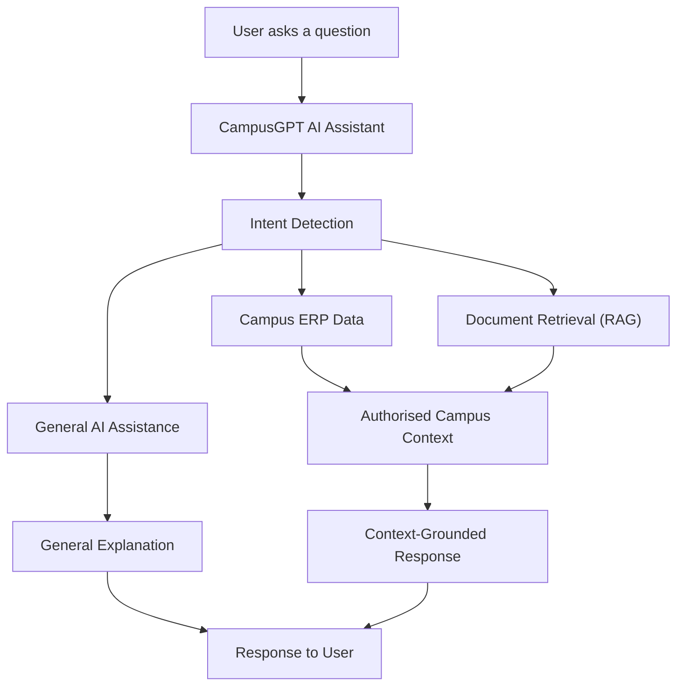
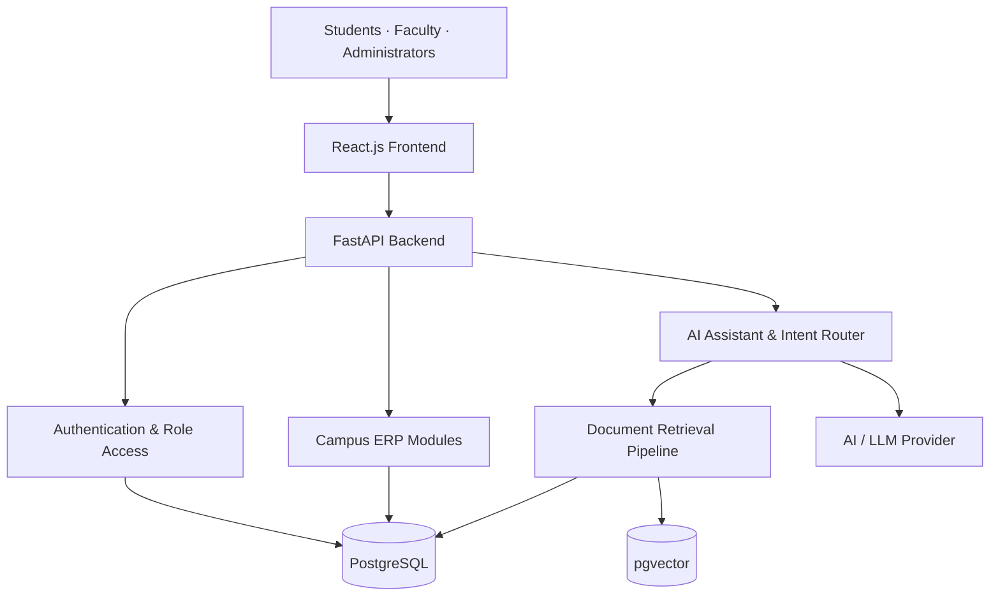

# 🎓 CampusGPT

### Your Campus. One Intelligent Platform.

**An AI-powered Campus ERP with a grounded AI assistant — connecting academic management, campus information, and student support in one unified experience.**

  
  
  
  

  <a href="#-about-campusgpt">About</a> •
  <a href="#-the-campus-experience">Campus Experience</a> •
  <a href="#-features">Features</a> •
  <a href="#-ai-powered-campus-assistant">AI Assistant</a> •
  <a href="#-technology">Technology</a>

---

## 🌌 About CampusGPT

CampusGPT is an intelligent, unified campus management platform designed to simplify the academic experience for students, faculty, and administrators.

It brings essential campus activities — including attendance, timetables, assignments, notices, academic documents, and student information — together in one connected environment.

At its core, CampusGPT combines the capabilities of a traditional **Campus ERP** with an **AI-powered assistant**. Instead of navigating multiple sections or searching through scattered documents, users can access relevant campus information and interact with it through a conversational interface.

The platform is designed around three ideas:

- **Connect** — bring academic and administrative activities into one platform.
- **Simplify** — make campus information and everyday tasks easier to access.
- **Assist intelligently** — use AI to help users find relevant, institution-specific information.

## 🎯 The Campus Experience

CampusGPT provides a role-oriented experience for the different people who make up an academic institution.

<table>
<tr>
<td width="33%" align="center">

### 🎓 Students

A personal academic space to follow schedules, attendance, assignments, notices, documents, and opportunities.

</td>
<td width="33%" align="center">

### 👩‍🏫 Faculty

A workspace for academic activities, classroom information, attendance, assignments, and communication with students.

</td>
<td width="33%" align="center">

### 🛡️ Administrators

A centralised view of campus operations, users, academic information, and institutional activities.

</td>
</tr>
</table>

## ✨ Features

### 🔐 1. Secure Authentication & Role-Based Access

- User registration and sign-in.
- Email OTP verification.
- Google OAuth authentication.
- JWT-based authentication.
- Role-aware access for students, faculty, and administrators.
- Protected access to personal and institutional information.

### 🎓 2. Student Dashboard

A central academic dashboard that brings a student's important information together.

- Personal academic overview.
- Attendance summaries.
- Today's and upcoming timetable.
- Assignment deadlines and submission status.
- Latest campus notices.
- Academic documents and learning resources.
- Relevant academic updates and opportunities.

### 👩‍🏫 3. Faculty Dashboard

A dedicated workspace to support teaching and academic responsibilities.

- Class and timetable overview.
- Attendance management.
- Assignment creation and submission tracking.
- Student-related academic information.
- Notices and classroom communication.
- Access to relevant academic documents.

### 🛡️ 4. Admin Dashboard

A unified administrative workspace for managing campus information and activities.

- Student and faculty information management.
- Academic and course information.
- Timetable and attendance oversight.
- Notices and announcements.
- Document and institutional information management.
- Overview of important campus activities.

### 📅 5. Timetable Management

- View daily and weekly class schedules.
- Organise timetable information by class, subject, and faculty.
- Access upcoming academic sessions.
- Keep timetable information available from the relevant dashboards.

### 📊 6. Attendance Management

- Record and manage attendance.
- View attendance by subject and academic period.
- Track attendance summaries and percentages.
- Help students understand their attendance status.
- Support faculty and administrative attendance workflows.

### 📝 7. Assignment Management

- Publish assignments with descriptions and deadlines.
- Share assignment-related resources.
- Submit and manage student submissions.
- Track submission status and deadlines.
- Keep assignment information organised by course or subject.

### 📢 8. Notices & Notifications

- Publish campus-wide and targeted notices.
- Share academic announcements and important updates.
- Keep students and faculty informed.
- Organise notices by category and relevance.

### 📁 9. Document Management

- Upload and organise academic documents.
- Support common document formats such as PDF and DOCX.
- Access course materials, notes, notices, and institutional documents.
- Make relevant documents available to authorised users.
- Provide document content as a knowledge source for the AI assistant.

### 🤖 10. CampusGPT AI Assistant

A conversational assistant designed around campus-specific questions and tasks.

- Ask questions in natural language.
- Find relevant academic and institutional information.
- Get assistance with timetables, attendance, assignments, notices, and documents.
- Route questions to the appropriate information source.
- Provide responses grounded in authorised campus information.
- Support context-aware assistance for different user roles.

### 🔎 11. Intelligent Document Search (RAG)

Retrieval-Augmented Generation (RAG) helps the assistant answer questions using relevant institutional documents.

- Document ingestion and processing.
- Text extraction and chunking.
- Embedding generation.
- Semantic similarity search.
- Context retrieval from relevant documents.
- Source-grounded answer generation.

### 🧭 12. Intent Detection & Intelligent Routing

CampusGPT is designed to understand the purpose behind a user's question and select an appropriate response path.

- Identify the intent of a user query.
- Distinguish campus-data questions from document questions and general queries.
- Route requests to relevant backend tools or retrieval systems.
- Apply user permissions before accessing protected information.
- Return responses based on the selected source.

### 📈 13. Academic Analytics

- Attendance and academic summaries.
- Visual insights into academic activity.
- Progress trends and useful indicators.
- Data-driven views for students, faculty, and administrators.

### 🎯 14. Placement & Career Opportunities

- Placement-related information.
- Company and opportunity details.
- Internship discovery.
- Hackathon and competition updates.
- Centralised access to career-related opportunities.

### 🧠 15. Course Recommendation System

- Explore relevant courses and learning resources.
- Discover learning paths based on academic interests.
- Support informed learning and skill-development choices.

### 🖼️ 16. Visual Learning Workspace

An interactive learning environment designed to make complex academic topics easier to explore.

- Visual explanations of concepts.
- Structured learning content.
- Interactive learning experiences.
- A richer companion to traditional study materials.

### 🎙️ 17. Voice Interaction

- Voice-based interaction with the CampusGPT assistant.
- Natural conversational access to campus information.
- An additional interaction mode for hands-free assistance.

## 🧩 Technology Stack by Module

CampusGPT follows a modular architecture in which each feature uses a combination of frontend technologies, backend services, database operations, and specialised libraries where required.

The following table describes the technology stack associated with each major module.

### 1. Authentication & Role-Based Access

| Layer | Technologies |
|---|---|
| Frontend | React.js, JavaScript, Tailwind CSS |
| Backend | Python, FastAPI |
| Authentication | JWT, Google OAuth 2.0, Email OTP |
| Data Validation | Pydantic |
| Database | PostgreSQL |
| ORM | SQLAlchemy 2.x |
| Security | Password hashing, protected API routes, role-based access control |

**Purpose:** Handles user registration, login, identity verification, session authentication, and access permissions for different campus roles.

### 2. Student Dashboard

| Layer | Technologies |
|---|---|
| Frontend | React.js, JavaScript, Tailwind CSS, Lucide React |
| Backend | FastAPI |
| API Communication | REST APIs |
| Database | PostgreSQL |
| ORM | SQLAlchemy 2.x |
| Authentication | JWT-based protected routes |

**Purpose:** Retrieves and displays personalised academic information such as attendance, timetable, assignments, notices, and student details.

### 3. Faculty Dashboard

| Layer | Technologies |
|---|---|
| Frontend | React.js, JavaScript, Tailwind CSS |
| Backend | FastAPI |
| API Communication | REST APIs |
| Database | PostgreSQL |
| ORM | SQLAlchemy 2.x |
| Authentication | JWT and role-based access control |

**Purpose:** Provides faculty members with access to classroom information, attendance operations, assignment management, and academic communication.

### 4. Admin Dashboard

| Layer | Technologies |
|---|---|
| Frontend | React.js, JavaScript, Tailwind CSS |
| Backend | FastAPI |
| Database | PostgreSQL |
| ORM | SQLAlchemy 2.x |
| Data Validation | Pydantic |
| Authentication | JWT and role-based access control |

**Purpose:** Supports administrative operations, institutional data management, user management, and academic oversight.

### 5. Timetable Management

| Layer | Technologies |
|---|---|
| Frontend | React.js, JavaScript |
| Backend | FastAPI |
| API Communication | REST APIs |
| Database | PostgreSQL |
| ORM | SQLAlchemy 2.x |
| Data Validation | Pydantic |

**Purpose:** Manages timetable records, class schedules, subjects, faculty assignments, and upcoming academic sessions.

### 6. Attendance Management

| Layer | Technologies |
|---|---|
| Frontend | React.js, JavaScript |
| Backend | FastAPI, Python |
| Database | PostgreSQL |
| ORM | SQLAlchemy 2.x |
| API Communication | REST APIs |
| Authentication | JWT and role-based access control |

**Purpose:** Records attendance, calculates attendance percentages, and provides attendance summaries for students, faculty, and administrators.

**Optional face-recognition attendance extension:**

| Component | Technologies |
|---|---|
| Camera Interface | React.js, Browser MediaDevices API |
| Image Processing | OpenCV |
| Face Detection | InsightFace / SCRFD |
| Face Recognition | ArcFace embeddings |
| Backend Processing | Python, FastAPI |
| Vector Storage | PostgreSQL, pgvector |

*Note: The face-recognition stack is an optional extension. Model licensing, biometric consent, anti-spoofing, and secure handling of face embeddings must be considered before deployment.*

### 7. Assignment Management

| Layer | Technologies |
|---|---|
| Frontend | React.js, JavaScript |
| Backend | FastAPI |
| Database | PostgreSQL |
| ORM | SQLAlchemy 2.x |
| Data Validation | Pydantic |
| File Handling | FastAPI file upload support |

**Purpose:** Handles assignment creation, deadlines, student submissions, submission tracking, and assignment-related resources.

### 8. Notices & Notifications

| Layer | Technologies |
|---|---|
| Frontend | React.js, JavaScript |
| Backend | FastAPI |
| Database | PostgreSQL |
| ORM | SQLAlchemy 2.x |
| Realtime Communication | WebSocket |
| API Communication | REST APIs |

**Purpose:** Manages campus announcements, targeted notices, and notification updates. WebSockets can support real-time delivery where implemented.

### 9. Document Management

| Layer | Technologies |
|---|---|
| Frontend | React.js, JavaScript |
| Backend | FastAPI, Python |
| File Upload | FastAPI UploadFile |
| Database | PostgreSQL |
| ORM | SQLAlchemy 2.x |
| Supported Formats | PDF, DOCX |
| Document Processing | Python document-processing libraries |

**Purpose:** Supports document uploads, organisation, storage metadata, and retrieval of academic and institutional resources.

*Note: The exact PDF/DOCX extraction libraries depend on the document-processing implementation.*

### 10. CampusGPT AI Assistant

| Layer | Technologies |
|---|---|
| Frontend | React.js, JavaScript |
| Backend | Python, FastAPI |
| AI Integration | LLM API / AI model provider |
| Request Processing | Intent Detection and Routing |
| Data Access | PostgreSQL |
| Authentication | JWT |
| Realtime Communication | WebSocket |

**Purpose:** Processes natural-language questions, identifies user intent, retrieves relevant information, and generates context-aware responses.

### 11. Intelligent Document Search (RAG)

| Layer | Technologies |
|---|---|
| Backend | Python, FastAPI |
| Document Processing | PDF/DOCX extraction libraries |
| Text Processing | Python |
| Embeddings | Embedding model |
| Vector Database | PostgreSQL with pgvector |
| Similarity Search | pgvector |
| Response Generation | LLM API / AI model provider |

**Purpose:** Implements Retrieval-Augmented Generation by processing institutional documents, generating embeddings, retrieving relevant text chunks, and supplying contextual information to the language model.

### 12. Intent Detection & Intelligent Routing

| Layer | Technologies |
|---|---|
| Frontend | React.js, JavaScript |
| Backend | Python, FastAPI |
| Intent Processing | Python-based intent detection |
| Routing | Modular backend service architecture |
| Data Retrieval | PostgreSQL, SQLAlchemy |
| Document Retrieval | PostgreSQL, pgvector |
| Authentication | JWT and role-based access control |

**Purpose:** Determines whether a question requires campus ERP data, document retrieval, or general AI assistance and routes it to the appropriate backend service.

### 13. Academic Analytics

| Layer | Technologies |
|---|---|
| Frontend | React.js, JavaScript |
| Backend | FastAPI |
| Data Processing | Python |
| Database | PostgreSQL |
| ORM | SQLAlchemy 2.x |
| Visualisation | Charting library (implementation-dependent) |

**Purpose:** Processes academic records and presents attendance summaries, academic indicators, and progress trends.

### 14. Placement & Career Opportunities

| Layer | Technologies |
|---|---|
| Frontend | React.js, JavaScript |
| Backend | FastAPI |
| Database | PostgreSQL |
| ORM | SQLAlchemy 2.x |
| API Communication | REST APIs |
| Authentication | JWT and role-based access control |

**Purpose:** Organises placement information, internship opportunities, company details, and career-related updates.

### 15. Course Recommendation System

| Layer | Technologies |
|---|---|
| Frontend | React.js, JavaScript |
| Backend | Python, FastAPI |
| Data Processing | Python |
| Database | PostgreSQL |
| ORM | SQLAlchemy 2.x |
| Recommendation Logic | Recommendation algorithm (implementation-dependent) |

**Purpose:** Uses academic interests and relevant learning information to help users discover suitable courses and learning paths.

### 16. Visual Learning Workspace

| Layer | Technologies |
|---|---|
| Frontend | React.js, JavaScript, Tailwind CSS |
| Backend | FastAPI |
| Content Processing | Python |
| AI Integration | LLM API / AI model provider |
| Database | PostgreSQL |

**Purpose:** Presents structured educational content and interactive learning experiences.

### 17. Voice Interaction

| Layer | Technologies |
|---|---|
| Frontend | React.js, JavaScript |
| Browser Audio | Web Audio API / MediaDevices API |
| Backend | FastAPI |
| Speech Recognition | Speech-to-Text service (implementation-dependent) |
| Voice Generation | Text-to-Speech service (implementation-dependent) |
| AI Integration | CampusGPT AI Assistant |

**Purpose:** Enables voice-based interaction with the assistant through speech recognition and speech synthesis services.

### Shared Infrastructure & Development Tools

The following technologies support the overall CampusGPT application rather than belonging to only one module.

| Category | Technologies |
|---|---|
| Frontend Build Tool | Vite |
| Frontend Framework | React.js |
| Programming Languages | JavaScript, Python |
| Backend Framework | FastAPI |
| Data Validation | Pydantic |
| ORM | SQLAlchemy 2.x |
| Database Migrations | Alembic |
| Primary Database | PostgreSQL |
| Vector Search | pgvector |
| Authentication | JWT, Google OAuth, Email OTP |
| Realtime Communication | WebSocket |
| Reverse Proxy | Nginx |
| Containerisation | Docker |
| Multi-container Management | Docker Compose |
| Version Control | Git, GitHub |
| API Documentation | FastAPI / OpenAPI, Swagger UI |

**Architecture Note:** CampusGPT uses a modular application architecture. Modules share common backend services, authentication, database infrastructure, and API communication rather than requiring a separate technology stack or server for every feature.

## 🧠 AI-Powered Campus Assistant

CampusGPT is designed to go beyond a conventional chatbot.

A campus question may require live academic data, information from an uploaded document, or a general explanation. The assistant uses intent detection and routing to select the appropriate path.

### Grounded, role-aware responses

- Campus-specific answers are based on available institutional data and documents.
- Access permissions are enforced before protected information is retrieved.
- The assistant is designed not to invent campus facts when the required information is unavailable.
- General AI explanations are distinct from answers sourced from institutional records.

## 🏗️ High-Level Architecture

CampusGPT uses a modular application architecture with a React frontend, FastAPI backend, and PostgreSQL database.

## 🛠️ Technology

| Layer | Technologies |
|---|---|
| Frontend | React.js, JavaScript (JSX), Vite |
| UI & Styling | Tailwind CSS v4 |
| Icons | Lucide React |
| Backend | Python, FastAPI |
| Data validation | Pydantic |
| ORM | SQLAlchemy 2.x |
| Database migrations | Alembic |
| Primary database | PostgreSQL |
| Vector search | pgvector |
| Authentication | JWT, Google OAuth, Email OTP |
| Realtime communication | WebSocket |
| Reverse proxy | Nginx |
| Containerisation | Docker, Docker Compose |

## 🧱 Design Principles

- **Unified experience:** keep essential campus workflows connected.
- **Role-aware by design:** provide relevant functionality according to user permissions.
- **Security first:** protect student, faculty, and institutional information.
- **Grounded AI:** base campus-specific responses on authorised information sources.
- **Modular architecture:** keep features organised and maintainable.
- **Accessible information:** make academic resources easier to discover and use.

---

### 🌱 One campus. Connected knowledge. Smarter experiences.

**CampusGPT**  
*Learn · Connect · Thrive*

An intelligent campus experience for the academic community.

